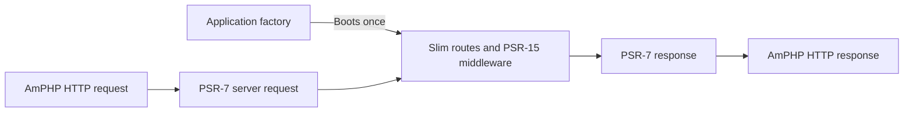

# Slim AmPHP Bridge

Run a Slim 4 application on AmPHP's persistent HTTP server. The application factory
builds Slim and its middleware once per server instance.



## Install

```sh
composer require rogervila/slim-amphp-bridge
```

Requires PHP 8.2 or later. The server runs on Windows and Linux using TCP sockets.
Linux supports additional event-loop drivers for high-concurrency deployments.

## Run the example

From a repository checkout, install the development dependencies and run the entry point.
The example app lives in the repository for local use and CI.

```sh
composer install
php examples/public/index.php
```

The [todo collection](http://127.0.0.1:1337/todos) starts empty. Each todo has
a server-assigned string ID, a title, and a `completed` flag that defaults to
`false`. The store lives in memory and resets when the server restarts.

The routes use `[TodoController::class, 'method']`. PHP-DI shares one controller
per app and injects route arguments by name. [PHP-DI Slim integration](https://php-di.org/doc/frameworks/slim.html)
[Route definitions](examples/routes.php) · [Todo controller](examples/src/TodoController.php)

| Request | Success |
| --- | --- |
| `GET /todos` | `200` with the collection |
| `POST /todos` | `201` with the created todo and a `Location` header |
| `GET /todos/{id}` | `200` with one todo |
| `PATCH /todos/{id}` | `200` with the updated todo |
| `DELETE /todos/{id}` | `204` with an empty body |

The API uses `application/json`. The collection returns a JSON array. Create,
read, and update return an object with `id`, `title`, and `completed` from the
[Todo DTO](examples/src/Todo.php). Errors return an `error` message.

Send `title` and an optional `completed` flag to create a todo. For updates,
put the ID in the URL and send the fields you want to change.

```sh
curl -i http://127.0.0.1:1337/todos \
  -H 'Content-Type: application/json' \
  --data '{"title":"Buy milk"}'
```

Use the ID or `Location` header from the response for subsequent requests.
On a fresh server, the first ID is `"1"`.

```sh
curl http://127.0.0.1:1337/todos/1

curl -i -X PATCH http://127.0.0.1:1337/todos/1 \
  -H 'Content-Type: application/json' \
  --data '{"completed":true}'

curl -i -X DELETE http://127.0.0.1:1337/todos/1
```

`composer test` exercises todo CRUD over loopback TCP and launches
`examples/public/index.php` on an OS-assigned port. Pass a port to the entry
point to override `1337`, or pass `0` to let the OS choose a free port.

## Use your Slim app

Create `routes.php` in your application root.

```php
<?php

declare(strict_types=1);

use Psr\Http\Message\ResponseInterface;
use Psr\Http\Message\ServerRequestInterface;
use Rogervila\SlimAmphpBridge\Http\ResponseAs;
use Slim\App;

/** @param App<null> $app */
return static function (App $app): void {
    $app->get('/', static function (
        ServerRequestInterface $request,
        ResponseInterface $response,
    ): ResponseInterface {
        return ResponseAs::text($response, 'OK');
    });
};
```

Create `public/index.php` to boot Slim and load the routes.

```php
<?php

declare(strict_types=1);

use Nyholm\Psr7\Factory\Psr17Factory;
use Rogervila\SlimAmphpBridge\Bridge\AmphpServerFactory;
use Rogervila\SlimAmphpBridge\Contract\ApplicationFactoryInterface;
use Slim\App;

require __DIR__ . '/../vendor/autoload.php';

$factory = new class implements ApplicationFactoryInterface {
    /** @return App<null> */
    public function create(): App
    {
        $app = new App(new Psr17Factory());
        $registerRoutes = require __DIR__ . '/../routes.php';
        $registerRoutes($app);

        $app->addRoutingMiddleware();
        $app->addErrorMiddleware(false, true, true);

        return $app;
    }
};

AmphpServerFactory::create($factory)->run();
```

The factory accepts named arguments for `host` (IPv4 or IPv6), `port`, a PSR-3
`logger`, and optional PSR-17 `requestFactory` and `streamFactory` implementations.
The defaults are `127.0.0.1`, `1337`, `NullLogger`, and Nyholm's PSR-17 factory.

For optional graceful shutdown, pass an AmPHP cancellation to `run($shutdown)`.
An event-loop callback or supervisor integration can trigger that cancellation
when the host requests shutdown. Use `start()` and `stop()` to manage the server
from an existing event loop. Call `stop()` from outside active request handlers
so AmPHP can drain them. To let the OS choose a free port, pass `port: 0` and
read `getAddress()` after startup. The bridge requires no Unix signals.

The adapter passes headers, query parameters, cookies, attributes, and socket metadata
into PSR-7. It buffers request and response bodies. AmPHP enforces its incoming body
size limit, and applications can parse the raw request body with Slim middleware.
Configure Slim error middleware for application HTTP errors such as 404 and 405.
The bridge logs unhandled errors through the supplied logger and serves a generic
JSON 500 response.

## Response helpers

Import `Rogervila\SlimAmphpBridge\Http\ResponseAs` and pass the PSR-7 response
supplied by Slim.

| Call | Result |
| --- | --- |
| `ResponseAs::json($response, ['id' => 42], status: 201)` | JSON with `application/json` |
| `ResponseAs::text($response, 'OK')` | UTF-8 plain text |
| `ResponseAs::html($response, '<h1>Hello</h1>')` | UTF-8 rendered HTML |
| `ResponseAs::redirect($response, '/todos/1', status: 303)` | Empty redirect with a `Location` header |
| `ResponseAs::noContent($response)` | Empty HTTP 204 response |

Each helper returns a response with a fresh body stream. The JSON, text, and
HTML helpers use the input response's status by default and reject statuses
that prohibit content. JSON encoding errors throw `JsonException`.

Redirects default to 302 and accept 301, 302, 303, 307, and 308. The location
can be a string or a PSR-7 `UriInterface`. Empty locations and locations
containing spaces or control characters are rejected.

The helpers clear `Content-Length`, `Content-Encoding`, `Content-Range`,
`Transfer-Encoding`, and `Trailer` when replacing a body. Headers such as
`Set-Cookie` remain available on the returned response.

## Concurrent requests

Use non-blocking clients for I/O on the event loop. Start independent operations
with `Amp\async()` and join their futures with `Amp\Future\await()`. The bridge
integration tests exercise overlapping operations within one request. Apply
timeouts and cancellation at I/O boundaries. Blocking clients stall the event
loop. Offload blocking calls or CPU-bound work with `amphp/parallel` when
appropriate.

Keep user data and request state in local variables or PSR-7 attributes. The
application and its services can handle overlapping requests in the same process.

## Checks

```sh
composer validate --strict
composer test
composer analyse
composer style
```

GitHub Actions runs these checks on Ubuntu and Windows with PHP 8.2, 8.3, and 8.4.
